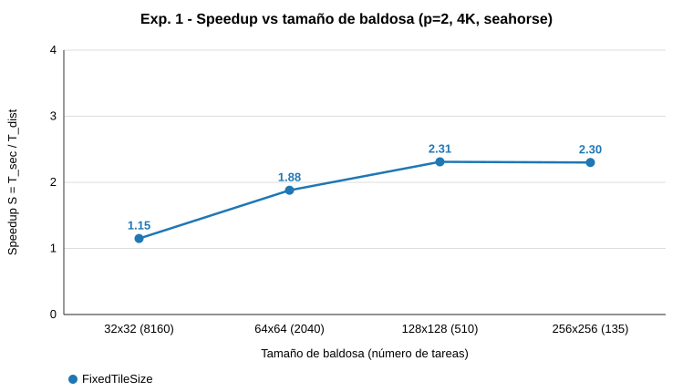
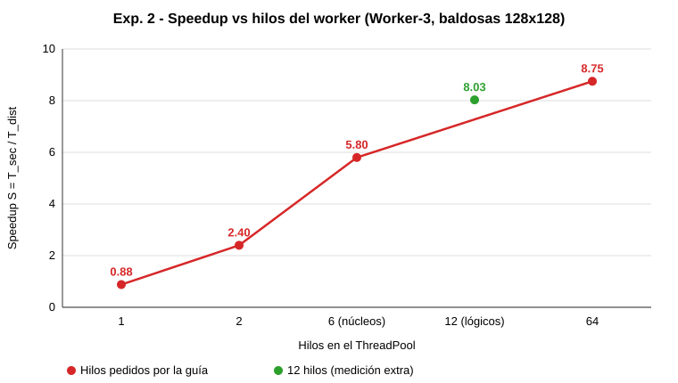

# Informe técnico – Renderizado paralelo de Mandelbrot (Master-Worker / Bag of Tasks)

> Datos de respaldo en `docs/resultados_experimentos.md`; logs originales en `output/logs/. Gráficas en `docs/img/`.

Integrantes: 

- Jonathan David Cortés Castaño
- Santiago Gómez López
- Juan Diego Domínguez Arias

## 1. Entorno experimental
- Región `seahorse`, 4K (3840×2160), maxIter 5000. Master en el PC del cliente (Wi-Fi/hotspot); workers en PCs distintos.
- T_sec = 156 710 ms (monolito, 1 hilo, PC del Master, 16 hilos lógicos; ver `docs/reporte_monolito.md`).
- Todas las corridas validadas celda por celda contra el monolito (`VERIFICACION OK`).
- S = T_sec/T_dist y E = S/p·100 %. Una medición por celda en el Exp. 1; dos corridas por celda en los Exp. 2 y 3 (tres en 1 hilo).

## 2. Experimento 1 – Granularidad (p=2)
Región `seahorse`, 4K, 5000 iteraciones, Worker-3 y Worker-2 (6 hilos cada uno), T_sec = 156 710 ms. Todas las corridas validadas (`VERIFICACION OK`).

**Tabla 1.** Impacto de la granularidad (una medición por celda, 2026-10-15):

| Estrategia | Parámetro | Tareas | T_sec (ms) | T_dist (ms) | Speedup (S) | Eficiencia (E) |
|---|---|---|---|---|---|---|
| FixedCount (franjas) | N = 2 | 2 | 156 710 | 63 245 | 2.48× | 123.9 % |
| FixedCount (franjas) | N = 4 | 4 | 156 710 | 43 966 | 3.56× | 178.2 % |
| FixedCount (franjas) | N = 16 | 16 | 156 710 | 63 506 | 2.47× | 123.4 % |
| FixedTileSize (grano ultrafino) | 32×32 | 8 160 | 156 710 | 136 833 | 1.15× | 57.3 % |
| FixedTileSize | 64×64 | 2 040 | 156 710 | 83 334 | 1.88× | 94.0 % |
| FixedTileSize (grano intermedio) | 128×128 | 510 | 156 710 | 67 736 | 2.31× | 115.7 % |
| FixedTileSize (grano grueso) | 256×256 | 135 | 156 710 | 68 240 | 2.30× | 114.8 % |

- Entre las baldosas, 128×128 (67 736 ms) y 256×256 (68 240 ms) son las mejores y prácticamente empatan; 32×32 es la peor (S = 1.15×). Elegimos 128×128 para los Exp. 2 y 3 (con 510 tareas hay balance de carga suficiente sin el sobrecosto de las 8 160 de 32×32).
- FixedCount N=4 fue la más rápida (43 966 ms), pero por un reparto casual de 2+2 franjas (ver P3), no por mérito de la estrategia.
- **E > 100 %:** varias celdas superan el 100 % porque T_sec se midió con un solo hilo en el PC del Master, y los workers son otros PCs más rápidos por hilo; S y E contra ese T_sec sirven para comparar filas, no como eficiencia absoluta. Por eso en el Exp. 3 se usa el speedup relativo T(1)/T(p).
- **Salvedad de calidad de datos:** el Exp. 1 se midió el 15-oct, cuando el PC de Worker-3 estaba degradado (esa misma sesión dio p=1 anómalo). Con baldosas 128×128 y p=2, el Exp. 1 dio 67 736 ms, mientras que el 16-oct el mismo caso dio 13 889–15 282 ms (≈4.6× menos). Por tanto los tiempos absolutos de la Tabla 1 no son comparables con los de los Exp. 2 y 3; el orden relativo entre configuraciones (32×32 peor, 128/256 mejores) sí es coherente con la teoría. No se repitió por falta de tiempo.

## 3. Experimento 2 – Hilos por worker
Worker-3 (6 núcleos físicos / 12 hilos lógicos) como único worker, baldosas 128×128 (la mejor del Exp. 1 en nuestros datos; el enunciado sugiere 64×64 solo como ejemplo), 2 corridas por celda (3 en 1 hilo por su inestabilidad), todas validadas. S = T_sec/T_dist con T_sec = 156 710 ms (medido en otro PC).

| Hilos | T_dist (ms) | Media (mediana en 1 hilo) | S | Cómputo por baldosa (ms) |
|---|---|---|---|---|
| 1 | 177 361 / 394 068 / 137 286 | 177 361 | 0.88× | 312 / 734 / 225 |
| 2 | 66 221 / 64 415 | 65 318 | 2.40× | ≈218 |
| 6 (núcleos físicos) | 26 227 / 27 781 | 27 004 | 5.80× | ≈250 |
| 12 (hilos lógicos) | 18 682 / 20 343 | 19 513 | 8.03× | ≈340 |
| 64 (sobredimensionado) | 18 161 / 17 646 | 17 904 | 8.75× | ≈1 750 |

La gráfica incluye los 12 hilos solo como medición extra; la guía pide 1, 2, núcleos físicos (6) y 64.

- Hasta 6 hilos el costo por baldosa casi no cambia: cada hilo tiene un núcleo propio y el escalado es casi ideal frente a la corrida de 137 s.
- Con 12 hilos (hyperthreading) T_dist mejora 1.38× pero el costo por baldosa sube ~35 %: dos hilos comparten un núcleo.
- Con 64 hilos T_dist mejora solo 1.09× sobre 12 y el costo por baldosa se quintuplica (ver P5).
- Salvedades: 1 hilo es muy inestable en ese PC (137–394 s); con ≥2 hilos la dispersión es 3–9 %. La media de 6 hilos del Exp. 3 (23 252 ms, por la mañana) difiere 16 % de la de aquí (27 004 ms); hay variación entre sesiones. Las mediciones del 15-oct se descartaron por estar degradadas.

## 4. Experimento 3 – Escalabilidad y Amdahl
Baldosas 128×128, 6 hilos por worker, 2 corridas por celda (2026-10-16), validadas celda por celda.

| p | T_dist c1 (ms) | T_dist c2 (ms) | Media (ms) | S_rel = T(1)/T(p) | E_rel = S_rel/p |
|---|---|---|---|---|---|
| 1 | 23 569 | 22 934 | 23 252 | 1.00× | 100 % |
| 2 | 15 282 | 13 889 | 14 586 | 1.59× | 79.7 % |
| 4 | 7 516 | 7 234 | 7 375 | 3.15× | 78.8 % |

El reparto fue equilibrado (p=2: ~255 tareas por worker) y el cómputo por baldosa de Worker-3 fue el mismo con p=1 y p=2 (~226–230 ms), lo que indica que no hay interferencia entre workers.

**Corrección de datos:** el 15-oct se midió p=1 = 81 072 / 77 108 ms (≈3.4× más lento) y daba una caída superlineal de p=1 a p=2. Era una medición degradada del PC de Worker-3 (causa por confirmar); se descartó y se remidió. Como el speedup contra T_sec (156 710 ms) viene de otro PC, se usa S_rel = T(1)/T(p) para la eficiencia y Amdahl.

Reparto con p=4: Worker-1 (PC del Master) ~270 tareas, Worker-2 ~100, Worker-4 ~93, Worker-3 ~42; Bag of Tasks deja que los nodos más rápidos tomen más trabajo.

**Ley de Amdahl.** Con 1/S = (1−f) + f/p y la fracción secuencial de Karp-Flatt e(p) = (1/S − 1/p)/(1 − 1/p):

| p | S_rel | e(p) |
|---|---|---|
| 2 | 1.594 | 0.255 |
| 4 | 3.153 | 0.090 |

Con p=4, (1−f) ≈ 0.09 y el techo teórico sería 1/(1−f) ≈ 11×. El hecho de que e(p) baje al subir p indica que el modelo no se ajusta limpiamente: los nodos son heterogéneos (Worker-3, con el que se midió T(1), es el más lento, lo que infla S_rel para p=4) y la variación entre corridas de p=2 es ~10 %. La conclusión que sostienen los datos es que la parte estrictamente secuencial (partición, consolidación en el Master, E/S) es pequeña, del orden de 0.1 del tiempo o menos. Limitación: no medimos nodos idénticos.

## 5. Cuestionario

### P1. Trampa del espacio vacío vs. zona de estrés
Medimos el monolito a 4K y 5000 iteraciones: `classic` = **29 580 ms** frente a `seahorse` = **156 710 ms** (~5.3×), con los mismos píxeles y el mismo maxIter. El tiempo depende de las iteraciones realmente consumidas, no de maxIter: en `classic` la mayoría de los píxeles exteriores escapan en pocas iteraciones, así que el tope de 5000 casi nunca se alcanza; en `seahorse` la mayor parte de los píxeles está en la frontera y consume cerca de 5000. La vista macro hace parecer barato el problema (29 s monohilo es tolerable) y oculta que la carga real, cuando se hace zoom, necesita paralelismo. _Caveat:_ el monolito ajusta X al aspecto 16:9, por lo que `classic` abarca X∈[−2.0, 2.44]. Una sola medición.

### P2. Grano fino vs. sobrecosto de red
Con baldosas 32×32 se generan 8 160 tareas y T_dist = 136 833 ms (S = 1.15×, E = 57 %); con 64×64 son 2 040 tareas y 83 334 ms (S = 1.88×); con 128×128, 67 736 ms. En `master_exp1.log` muchas tareas de 32×32 reportan 0–6 ms de cómputo: el trabajo útil por tarea es comparable o menor que el costo de moverla.

Cada tarea cuesta al menos dos RPC (`pollTask` y `reportResult`) sin importar su tamaño. Ese costo fijo por tarea tiene tres componentes:
- **Serialización Slice:** cada llamada codifica un `TaskTile` y un `TileResult` con su `IntSeq` en binario. El resultado de una baldosa 32×32 son 1 024 enteros (~4 KB), pero el costo de armar y desarmar el mensaje, más los campos fijos (`jobId` como string, coordenadas, tamaños), se paga entero en cada una de las 8 160 tareas.
- **Encabezados y viaje de red:** cada invocación Ice añade su propio encabezado de protocolo sobre TCP y espera la respuesta. En una red Wi-Fi/hotspot el tiempo de ida y vuelta (milisegundos) supera con facilidad los pocos milisegundos de cómputo de una baldosa de la periferia.
- **Contención en el Master:** todos los workers y todos sus hilos compiten por la `ConcurrentLinkedQueue` y por la consolidación de resultados en la matriz final. Con miles de reportes pequeños, el Master se vuelve el cuello de botella serial y los workers esperan.

Por el contrario, con 128×128 se reparten 510 tareas, cada una con suficiente cómputo para amortizar el costo fijo, y con 256×256 (135 tareas) ya no mejora (68 240 ms): empieza a perder el balanceo porque quedan pocas tareas grandes al final. El grano óptimo está en medio. _Caveat:_ una sola medición por celda y red inalámbrica; no separamos experimentalmente serialización, red y contención, el reparto del costo es una interpretación apoyada en los tiempos por tarea.

### P3. Fracaso de la partición estática
Datos del Master (`output/logs/master_exp1.log`):

| N | Reparto | Cómputo acumulado (ms) | T_dist (ms) |
|---|---|---|---|
| 2 | W3: 2 tareas, W2: 0 | W3 107 990 | 63 245 |
| 4 | W3: 2, W2: 2 | W3 52 074 / W2 73 145 | 43 966 |
| 16 | W3: 6, W2: 10 | W3 110 121 / W2 86 821 | 63 506 |

Con N=2 un solo worker se llevó ambas franjas: hay solo 2 tareas y no hay garantía de que cada worker tome una; el otro worker queda ocioso. Con N=16 las franjas centrales (que atraviesan la frontera) tardaron 14–22 s y las de los extremos 7.9–9.7 s: la carga es heterogénea y el tiempo total lo fija la franja más lenta. Con Bag of Tasks de grano medio cada worker pide trabajo apenas termina, de modo que el worker rápido absorbe más tareas (p. ej. 128×128: W2 334 tareas vs. W3 176) y los núcleos no quedan ociosos. _Matiz:_ N=4 salió mejor que N=16 por el reparto casual 2+2 y no porque la partición estática sea buena.

### P4. Puntos de quiebre de hardware y memoria
**(a) Precisión de `double`.** Un `double` IEEE 754 tiene 53 bits de mantisa (~15–16 cifras decimales, epsilon ≈ 2.2×10⁻¹⁶). En `computePoint` las coordenadas se calculan como `xMin + x·dx`; cuando el paso `dx` entre píxeles vecinos se acerca al epsilon relativo de `xMin` (≈ 0.75 → paso mínimo ≈ 10⁻¹⁶), píxeles contiguos se redondean al mismo `double`. Con una imagen de 3840 píxeles de ancho eso ocurre cuando el ancho de la región baja de ~10⁻¹³ (magnificación del orden de 10¹³ respecto a la vista clásica de ancho 2.5). Los artefactos son bloques planos de un solo color (pixelación en cuadrícula) y filamentos que desaparecen, porque muchos píxeles reciben exactamente el mismo `c`. Nuestra región `seahorse` (ancho 0.01) está lejos de ese límite, así que no lo observamos; Este cálculo es teórico: no lo verificamos con un zoom de prueba. Sustituir por `BigDecimal` da precisión arbitraria y elimina el artefacto, pero cada operación aritmética pasa de una instrucción de hardware a una operación sobre objetos con asignación de memoria; el costo por iteración sube en uno o dos órdenes de magnitud, lo que haría inviable 4K a 5 000 iteraciones sin mucho más paralelismo.

**(b) Memoria RAM.** La matriz de iteraciones es `int[][]` (4 bytes por píxel). A 4K son 8 294 400 px ≈ 33 MB; a 16K (15 360×8 640 = 132.7 Mpx) ≈ 531 MB; a 32K (30 720×17 280 = 530.8 Mpx) ≈ 2.1 GB. Esa matriz existe en el Master (consolidación), en el cliente (resultado y matriz de verificación del monolito) y viaja serializada por Ice, lo que multiplica la presión: una sola imagen de 32K puede necesitar varios GB entre copias y buffers. No fijamos `-Xmx` en ningún `build.gradle`, de modo que el heap por defecto de la JVM es 1/4 de la RAM física del PC. Cuando se agota, la JVM lanza `java.lang.OutOfMemoryError: Java heap space`. En Ice, además, hay un límite de tamaño de mensaje (`Ice.MessageSizeMax`, 1 MB por defecto) que se alcanzaría antes con baldosas grandes o con una matriz completa. _Caveat:_ cálculo teórico; no se llegó a 16K/32K en pruebas.

### P5. Límites del ThreadPool y Ley de Amdahl
**Pool de 64 hilos.** El Worker-3 tiene 6 núcleos y 12 hilos lógicos. Subir de 12 a 64 hilos redujo T_dist solo de 19 513 a 17 904 ms (1.09×), pero el cómputo acumulado pasó de ≈174 000 a ≈892 000 ms y el costo por baldosa de ≈340 a ≈1 750 ms (~5×). No hubo colapso del tiempo total, pero sí una enorme pérdida de eficiencia: con 64 hilos listos y solo 12 hilos de hardware, el planificador del SO debe turnarlos, y cada **cambio de contexto** implica guardar y restaurar registros y estado del hilo, invalidar parte de las cachés L1/L2 y del TLB (cada hilo trabaja sobre su propia baldosa) y, con hyperthreading, repartir las mismas unidades de ejecución entre más hilos. Ese trabajo extra no produce píxeles: el hilo tarda más en terminar cada baldosa aunque haya más hilos en vuelo. Como la CPU ya estaba saturada con 12 hilos, el tiempo de pared apenas cambia, pero el costo de CPU se multiplica; con más memoria por hilo (pila, matrices de baldosa) o con baldosas más pequeñas el efecto sería peor. El punto práctico está en los hilos lógicos (12); los núcleos físicos (6) son el punto más eficiente por baldosa.

**Fracción secuencial (Amdahl).** Con S_rel = T(1)/T(p) (6 hilos por worker, 128×128) y 1/S = (1−f) + f/p: p=2 → S=1.59, (1−f) ≈ 0.25; p=4 → S=3.15, (1−f) ≈ 0.09. Ambos valores incluyen la partición, la consolidación incremental en el Master, la E/S de red y la parte del tiempo en que los workers esperan tareas. Nuestra mejor estimación es que la fracción estrictamente secuencial es del orden de **0.1 o menos** (el valor de p=2 está inflado por la variación de ~10 % entre sus corridas y el de p=4 por la heterogeneidad de los nodos, ver §4); esto limitaría el speedup a ≈1/(1−f) ≈ 10× con nodos de esta clase. Con una fracción de ese tamaño, añadir workers más allá de 8–10 no aportaría casi nada y el Master (consolidación en una sola matriz) pasaría a ser el cuello de botella.

## 6. Bitácora de uso ético de IAG (Nivel 3)
Herramienta: Claude Code (modelo Claude Sonnet 5.5) como asistente. El equipo ejecutó los workers en sus PCs, decidió cuándo lanzar cada corrida y validó los resultados.

**Prompts clave**
1. "Revisemos qué nos falta del experimento, veamos qué pasos siguen a partir de lo que tenemos guardado."
2. "El PDF está en docs" → la IA extrajo la guía con `pdftotext` y listó los entregables y el cuestionario."
3. "Worker-3 está listo con 6 hilos, lanza la corrida" (repetido para p=1, p=2, p=4 y para 1, 2, 6, 12 y 64 hilos, con aviso del equipo antes de cada corrida).

**Justificación crítica del código/análisis incorporado**
- No se modificó código fuente del proyecto (Master, Worker, Client, estrategias): solo se ejecutó y se midió. Se usaron los comandos de la guía.
- Los textos de P1–P5 se revisaron con apoyo de la IA a com ayuda de los datos medidos; las partes teóricas (P2 en sus mecanismos, P4a y P4b) son razonamiento técnico no verificado experimentalmente y así se marcan. La IA hizo cálculos (speedup relativo, Karp-Flatt, tamaño de la matriz a 16K/32K) que se contrastaron con los datos de las tablas.
